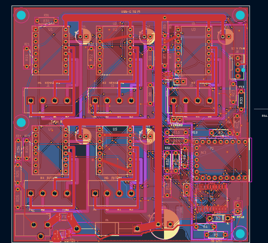

# November 9: Made the PCB

I spent quite a while making the schematics and routing a custom motor driver PCB. It is designed to control two NEMA 23s and three NEMA 17s using my 12V/4A supply; I still need to test the assembled board and combined load.

Budgeting was a really big problem as any drivers costed a lot and keeping it below $100 which was my goal turned out to be hard as I needed to figure out the drivers and I had to be extremely careful when routing and making the PCB in general as I didn't want the motors to overheat and not work.

I also have a backup option prepared just in case if the current PCB doesn't work which utilizes the drivers I'm ordering. Also, I already have 4 A4988 drivers. I'm not sure if the fourth one works though so I will need to double check it. I have attatched the PCB files in the repo too.

I utilized AI by having it check my PCB and fixing some errors that were in it and helping me know what to change in order to make it work well too and AI also helped me with the schematics by telling me what is wrong and adding some helpful labels for the future.

The board is extremely tight, wow! It felt like it took forever. Heres a picture of it too:

**Total time spent: 7 hours (approximately)**
