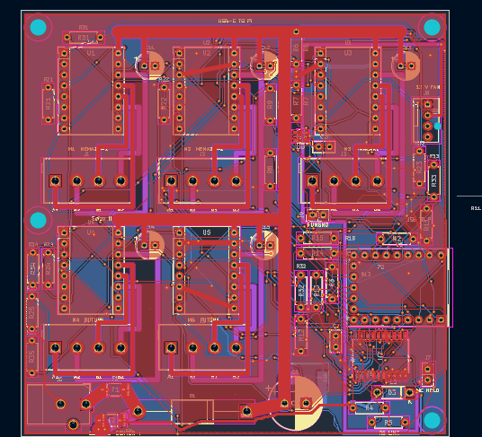
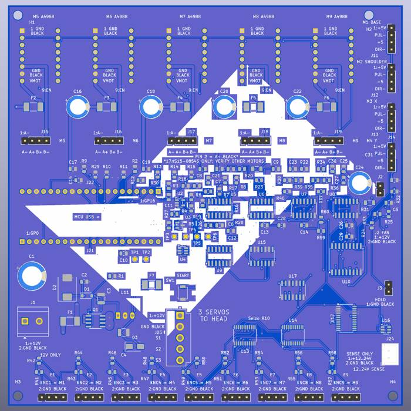

# November 9: Made the PCB

I spent quite a while making the schematics and routing a custom motor driver PCB. It is designed to control two NEMA 23s and three NEMA 17s using my 12V/4A supply; I still need to test the assembled board and combined load.

Budgeting was a really big problem as any drivers costed a lot and keeping it below $100 which was my goal turned out to be hard as I needed to figure out the drivers and I had to be extremely careful when routing and making the PCB in general as I didn't want the motors to overheat and not work.

I also have a backup option prepared just in case if the current PCB doesn't work which utilizes the drivers I'm ordering. Also, I already have 4 A4988 drivers. I'm not sure if the fourth one works though so I will need to double check it. I have attatched the PCB files in the repo too.

I utilized AI by having it check my PCB and fixing some errors that were in it and helping me know what to change in order to make it work well too and AI also helped me with the schematics by telling me what is wrong and adding some helpful labels for the future.

The board is extremely tight, wow! It felt like it took forever. Heres a picture of it too:

**Total time spent: 7 hours (approximately)**

# November 12th, Redesigned the PCB

Me and AI worked a ton on a new and improved PCB for 9 motors - 4 nema 23s and 5 nema 17s after I researched and examined the arm to my liking. I'm adding a few more motors because I wanted to have a modularity piece in it so I could attach a few more limbs to it so it can act like a scara kind of thing, a 3d printer, and a few more different inspirations. It also has space for 3 standard servos in order to make the gripper and tool-changing mechanism. I'm also reusing A4988 drivers and 3 TB6600 drivers too and 2 Nema 17 motors at least if not more.

This was an insane amount of wiring and AI helped me route it, diagnose errors, fix the schematic, and ran some checks to ensure it would work. At least I think the PCB is sorted now though

I had to work quite a bit on reducing the budget as it was always $300 or something insane every time I tried getting a quote. Nevertheless, I got a quote and I minimized the price as much as possible after finishing the Schematics and the PCB fully and routing it and adjusting it heavily and adding a logo too! I think it will look sick in blue.

**Total time spent: 8 hours**
